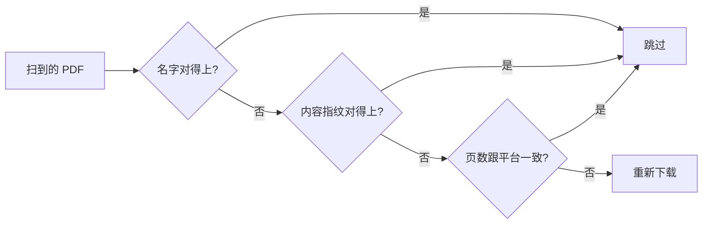

# 雨课堂课件下载器 · 幻灯片一键导出 PDF（RainClass，Linux / Windows）

> 把**本人已加入**的雨课堂（RainClass）课程幻灯片，按课程 / 讲次批量下载并合成 PDF。
> Linux 是 GTK4 原生界面，Windows 是 Qt 界面，都带命令行；Linux 可双击 `.deb` 安装。

**直接下载安装包**：[Releases 里的 `.deb`](https://github.com/zjfklss/yuketang-courseware/releases/latest) —— 不用自己构建。
Windows 用 Releases 里的 `yuketang-courseware-windows.zip`，解压后双击 `yuketang-courseware.exe`。


---

## 为什么会有这个东西

雨课堂（RainClass）只让你在网页里一页页翻幻灯片，**不提供下载，也不给 pptx**。期末复习时的典型状态是：手机相册里几百张截图，找「第 7 章那张图」找十分钟。

这个工具就是干这一件事的：

- **平台只给分片图片**，那就按页下原图，直接拼成 PDF——JPEG 字节原样嵌进 PDF（`/DCTDecode`），不解码、不重编码，画质和体积跟平台上的原图一致；
- **按课程、按讲次归堆**，文件名就是讲次名，跟 `机械设计/课件/`、`脑科学/课件/` 这种现成排法一致；
- **你已经下过的不会再下一遍**，哪怕文件被改过名、挪过位置。

只用你自己账号的登录态，只下你自己加入的课。

---

## 特性

| | |
|---|---|
| **真 PDF，不是打包截图** | 每页一张原图，直嵌不解码，体积基本等于平台原图之和 |
| **图形界面** | Linux：GTK4 + libadwaita；Windows：PySide6（Qt）。四步走完：登录 → 选课 → 勾讲次 → 下载 |
| **也能命令行** | `--all` 整批、`--course` 筛课程、`--term` 筛学期，可写进 cron / 计划任务 |
| **登录隔离** | 独立的浏览器配置目录，不读你日常 Edge / Chrome 的 Cookie，两套互不干扰 |
| **认已有文件** | 名字（含中文数字、全半角、标点差异）、内容指纹、页数三层比对 |
| **整理旧文件** | 跟着你已有的目录习惯走，一讲多套都归位，同名不同内容绝不覆盖 |
| **断点友好** | 某页失败只少这一页，缺的页码写在结果里，重跑只补缺的 |
| **跨机器可诊断** | `--doctor` 一条命令查出缺 Python 还是缺 Gtk4 / 浏览器 |

---

## 为什么不用「浏览器打印 → 另存为 PDF」

单讲应急可以，长期用不行，差别在三点：

| | 浏览器打印 | 本工具 |
|---|---|---|
| **画质** | 重新栅格化到屏幕分辨率（约 96 DPI），放大发虚 | 平台原图字节直嵌，不重编码 |
| **内容** | 常只打当前页，或把播放器界面一起打进去 | 按页号取全部页面，播放器不进 PDF |
| **批量** | 一讲一讲点，264 讲要几小时 | 勾一次，讲次并发下载 |
| **重复处理** | 每次都要手动另存、手动改名 | 已有文件自动跳过，按课程/讲次归堆 |

它适合的场景很窄：只要某一讲、只想快速看一眼。整学期归档用这个工具。

---

## 不适合的情况

说清楚边界，省得你装完才发现：

- **平台上只有直链 PDF 的课件**：本工具走的是「幻灯片图片」这条路，这类课件会报「无幻灯片」跳过。这种课直接用浏览器打开那个 PDF 下载就行，本工具帮不上忙。
- **没加入的课**：只看得到你账号权限内的课程。
- **想要 pptx**：平台不提供，任何工具都变不出来。
- **macOS**：没做，也没测过。

---

## 快速开始

### 方式一：直接装 `.deb`（推荐）

到 [Releases](https://github.com/zjfklss/yuketang-courseware/releases/latest) 下载 `yuketang-courseware_*_all.deb`，然后：

```bash
sudo apt install ./yuketang-courseware_*_all.deb
```

依赖（Gtk4、libadwaita、PyGObject、Edge/Chrome）会由 apt 一起装上。`Architecture: all`，amd64 / arm64 通用。

### 方式二：从源码构建

```bash
git clone https://github.com/zjfklss/yuketang-courseware.git
cd yuketang-courseware
./build-deb.sh                                  # 只用 dpkg-deb，不需要 debhelper
sudo apt install ./dist/yuketang-courseware_*_all.deb
```

### 方式三：Windows

去 [Releases](https://github.com/zjfklss/yuketang-courseware/releases/latest) 下载 `yuketang-courseware-windows.zip`，解压到任意目录，双击 `yuketang-courseware.exe`。不需要装 Python。

命令行用同目录的 `yuketang-courseware-cli.exe`：

```powershell
.\yuketang-courseware-cli.exe --url '<粘贴的网址>' --list
.\yuketang-courseware-cli.exe --url '<网址>' --all --out "$HOME\Documents\课件"
```

自己构建（需要 Python 3.9+）：

```powershell
git clone https://github.com/zjfklss/yuketang-courseware.git
cd yuketang-courseware
powershell -ExecutionPolicy Bypass -File packaging\windows\build-windows.ps1
# 产物：dist\yuketang-courseware\yuketang-courseware.exe
```

脚本会建 `.venv`、装 `requirements-windows.txt`、跑测试，再用 PyInstaller 打包。
想要安装包的话，装一个 [Inno Setup](https://jrsoftware.org/isinfo.php)，在仓库根目录执行 `iscc packaging\windows\installer.iss`。

Windows 上的目录约定：设置存在 `%APPDATA%\yuketang-courseware\`，
缓存（讲次映射、下载指纹）在 `%LOCALAPPDATA%\yuketang-courseware\cache\`，
登录用的独立浏览器配置在 `%APPDATA%\yuketang-courseware\browser\`，都不碰你日常浏览器。

### 用

Linux 在应用菜单里点「雨课堂课件」，Windows 双击 `yuketang-courseware.exe`，
或者终端 `yuketang-courseware`。

1. 在自己的浏览器里打开雨课堂，随便点开一门课，把**地址栏整条网址**复制过来，粘进第 1 步，点「登录雨课堂」。
2. 弹出的浏览器窗口里扫码 / 输账号登录（这个窗口跟你平时的浏览器是两套配置）。登录成功后课程自动出现。
3. 勾讲次 → 选保存目录 → 开始下载。

**换一台电脑跑不起来**，先跑自检，它会直接告诉你缺什么、该装哪个包：

```bash
yuketang-courseware --doctor
```

```text
雨课堂课件 0.5.6 环境自检（Linux）

  ✓ Python       3.10.12（/usr/bin/python3）
  ✓ PyGObject    3.42.2
  ✓ Gtk 4        4.6
  ✓ libadwaita   1.0
  ✓ Pillow       已安装
  ✓ 浏览器        /usr/bin/google-chrome
  ✓ 配置目录      /home/you/.local/share/yuketang-courseware
  ✓ 缓存目录      /home/you/.cache/yuketang-courseware

全部通过，可以正常使用。
```

---

## 下完之后长什么样

```text
<你选的保存目录>/
├── 自动控制原理/
│   └── 课件/
│       ├── 第01讲 第1章绪论.pdf
│       ├── 第12讲-第7章（1）.pdf
│       └── 第12讲-第7章（1）-1.pdf      ← 一讲有多个幻灯片时加 -1、-2
├── 计算机网络/
│   └── 课件/
│       └── 第10讲 计算机网络(5)-传输层 -UDP&TCP协议.pdf
└── 计算方法/
    └── 课件/
        └── 第二章 插值法-1-1.pdf
```

- 没有幻灯片、下载失败的讲次**不会**生成空文件或占位文件，只在结果里说明；
- 已有文件不覆盖、不删除；
- 页数少于 3 的 PDF 视为没下完，会重下一次。

---

## 它怎么认「这个文件我已经有了」

程序**递归**扫你选的保存目录（含多级子目录），三层比对，对上就跳过：



- **名字**：忽略空格、标点、全半角、大小写，中文数字按阿拉伯数字算——`第04讲-第二章（3）`、`第四讲 第2章(3)`、`第４讲 第二章（三）` 是同一讲。
- **指纹**：自己下过的文件记 SHA-256，改名、挪位置照样认得出。只对「文件大小也对得上」的候选算哈希，目录里几千个 PDF 也不会卡。
- **页数**：名称对不上时按内容核对，页数一致就认定是同一讲。页数读不出来、或只有一两页（证据太弱）时宁可重下一次，不猜。

### 顺手整理

界面「保存 → 整理」，或 `--tidy`。规则只有一条底线：**只搬不删、绝不覆盖**（跟 aria2、Syncthing 一个路子）。

- **跟着你已经有的目录走**：你把课放在 `自控/`，就不会再建一个 `自动控制原理/`；
- **一讲多套幻灯片全部归位**，不会只搬一个；
- **同名但内容不同**：来的那份另存成 `第4讲 绪论（另一版本 2026-11-02）.pdf`，两份都留着，你看页数决定删哪个；同一目标最多 10 份，再多只报告；
- **认不出来的不动**，但会列出来，只列课件范围内的（`笔记/`、`习题/`、`_archive/` 这类不算）。

先看计划不执行：

```bash
yuketang-courseware --url '<网址>' --out ~/课件 --tidy --dry-run
```

---

## 命令行

```bash
yuketang-courseware --url '<粘贴的网址>' --list                        # 只列讲次，不下载
yuketang-courseware --url '<网址>' --all --out ~/课件                  # 整批下载（最新学期）
yuketang-courseware --url '<网址>' --all --course 自动控制             # 只下课程名含「自动控制」
yuketang-courseware --url '<网址>' --all --all-terms                   # 连同往年的课
yuketang-courseware --url '<网址>' --all --source leaf                 # 只要课件区的
yuketang-courseware --url '<网址>' --all --no-open --wait 30           # 复用已开着的登录窗口
```

| 开关 | 说明 |
|---|---|
| `--out` | 保存目录，默认当前目录 |
| `--tidy` / `--dry-run` | 整理已有文件 / 只看计划 |
| `--course` / `--term` / `--all-terms` | 按课程名、学期筛 |
| `--source {both,activity,leaf}` | 课堂活动 / 课件区 / 都要（默认） |
| `--jobs` / `--delay` | 同时几讲（默认 1）/ 课间隔秒数 |
| `--doctor` | 查环境，缺什么说什么 |
| `--on-conflict {keep-both,skip}` | 整理时同名不同内容：另存（默认）/ 只报告 |

退出码：`0` 成功，`1` 出错或有失败项，`2` 参数不对。完整手册 `man yuketang-courseware`。

命令行不依赖图形界面库，没有桌面也能跑（登录那一步还是要开浏览器窗口）。

---

## 不会卡住、也不会白等

- **切后台的标签页会被浏览器冻结**，冻结后调试求值会一直等到超时（看起来就是「卡住」）。启动时已关掉后台节流，遇到没响应先唤醒页面再重试一次，等待有上限。
- **窗口被关掉但浏览器还开着**：程序会把页面重新开回来，登录态还在配置目录里。
- **登录后读讲次**：11 门 264 讲，本地假服务端实测 34 次请求、1.4 秒（改之前 298 次、3.1 秒）。慢的话加 `YUKETANG_TIMING=1`，每个请求的耗时和汇总会打到 stderr。

---

## 兼容性

| 系统 | Python | 图形界面依赖 | 图形界面 | 命令行 |
|---|---|---|---|---|
| Windows 10 / 11 | 3.9+（打包版自带 3.12） | PySide6（打包自带） | ✓ | ✓ |
| Ubuntu 24.04 | 3.12 | GTK 4.14 / libadwaita 1.5 | ✓ | ✓ |
| Ubuntu 22.04 | 3.10 | GTK 4.6 / libadwaita 1.0 | ✓ | ✓ |
| Debian 12 | 3.11 | GTK 4.8 / libadwaita 1.2 | ✓ | ✓ |
| Ubuntu 20.04 / Debian 11 | 3.8 / 3.9 | 只有 GTK3 | ×（系统没有 Gtk4） | ✓ |

Linux 上高版本 API 全部做了能力检测：`Adw.ToolbarView`（1.4+）、`Adw.Banner`（1.3+）、
`Adw.AlertDialog`（1.5+）、`Gtk.FileDialog`（4.10+）缺了就走替代实现，所以 Ubuntu 22.04 上也能开窗口。
Windows 上用的是 Qt Widgets，高 DPI 缩放由 Qt 自己处理，不用额外配置。

需要系统里有 Edge 或 Chrome（登录和取数都靠它）：Windows 10/11 自带 Edge；
Linux 上装 `microsoft-edge` 或 `google-chrome` 之一。

---

## 常见问题

**和 RainClass 官方客户端有什么不同？**
官方客户端只做上课、答题、看直播，不提供课件打包下载。这个工具补的就是这一步：把已经上过的课的幻灯片收成本地 PDF。

**为什么是 PDF，不是 pptx？**
雨课堂只提供分片图片，没有 pptx 可下。输出是图片版 PDF：能搜索吗？不能，文字是图。但画质是原图，打印和看都够用。

**会读到我的日常浏览记录 / Cookie 吗？**
不会。登录发生在独立配置目录（Linux 是 `~/.local/share/yuketang-courseware/browser`，
Windows 是 `%APPDATA%\yuketang-courseware\browser`），跟日常浏览器完全隔离，也不解密你的 Cookie 库。

**能下别人没加入的课吗？**
不能。只列你自己账号能看到的课，接口权限由你的登录态决定。

**下到一半断了怎么办？**
重跑一遍即可。已完成的讲次会被认出来跳过，失败的页只补那一页。某一页反复失败时，结果里会写清缺第几页，其余页正常合成。

**Windows 上点「登录雨课堂」提示「调试端口没有响应」？**
旧版 Windows 包有个 bug：把系统里所有 Edge 进程都当成自己的登录窗口。现在的版本会自动收掉上次残留的登录窗口再重开；
如果还不行，用右上角菜单「关闭登录窗口」后重试。某些受限环境（容器、无桌面、安全软件拦住 Chromium 沙箱）可以追加启动参数排查：

```powershell
$env:YUKETANG_BROWSER_FLAGS = "--no-sandbox"
.\yuketang-courseware.exe
```

**图片会不会被压糊？**
不会。JPEG 原字节直接嵌进 PDF，没有解码再编码的过程，体积和画质都等于平台原图。

**支持 Windows / macOS 吗？**
Windows 支持：Releases 里有打包好的 zip，解压双击就能用，登录、选课、下载、整理都在。
macOS 没做——没机器测，不想发一个“应该能跑”的包。

**Windows 上要装 Python 吗？**
用 Releases 里的 zip 不用。自己构建才需要 Python 3.9+，构建脚本会建虚拟环境。

---

## 开发

```bash
python3 -m unittest discover -s tests -v     # 150 个用例，不联网、不起浏览器
python3 tests/bench_fetch.py 60              # 每次请求的自耗
python3 tests/bench_load.py 11 24 100        # 11 门 24 讲，数请求、量耗时
```

测试用本地假 DevTools 服务端（`tests/fake_devtools.py`）和假接口数据，覆盖：畸形返回、半张 JPEG、`../` 文件名、坏缓存、几千文件的目录、改名/挪位置后的识别、跨分区移动、旧版 GTK 兜底，以及两件容易回归的事——**重复请求不许再扫 `/proc`**、**浏览器已开着时再点「登录」不许死锁**。

```text
yuketang_courseware/
  app.py        # 图形界面入口：Windows 走 Qt，Linux 走 GTK
  app_qt.py     # Windows 窗口（PySide6）
  app_gtk.py    # Linux 窗口（GTK4 + libadwaita）
  platforms.py  # 配置/缓存目录、浏览器路径、打开文件夹等平台差异
  cli.py        # 命令行
  catalog.py    # 课程 / 课堂活动 / 课件区
  slides.py     # 下载页面、合成 PDF
  library.py    # 认已有文件、整理（只搬不删）
  pdf.py        # JPEG 直嵌的 PDF 写入器
  browser.py    # 独立配置目录的浏览器 + DevTools 取数
  cdp.py        # 极简 WebSocket / DevTools 客户端
  preflight.py  # --doctor 环境自检
packaging/windows/   # PyInstaller spec、构建脚本、Inno Setup
```

---

## 许可证

代码以 [MIT](LICENSE) 发布：可以自由使用、修改、再分发，保留版权声明即可。

**课件本身不在许可范围内**——那是授课教师和平台的版权，本仓库只提供工具，不附带任何课程资料。

---

## 免责声明

本项目只用于**下载本人已加入课程的资料**，方便离线复习。课件版权归授课教师与平台所有，**不要二次传播、不要商用**。使用时请遵守学校与雨课堂的服务条款；因不当使用造成的一切后果由使用者自负。

程序不内置任何学校地址、学号、姓名，也不绕过任何登录或权限校验——它用的就是你自己的登录态。
